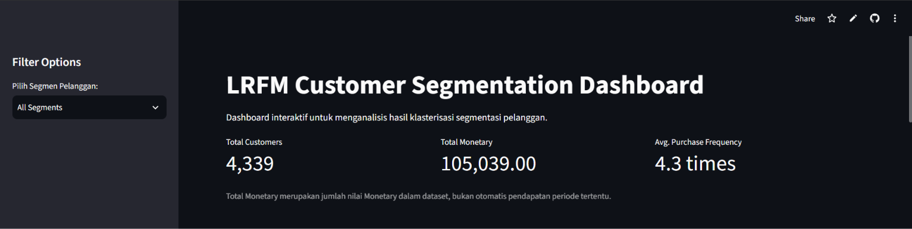
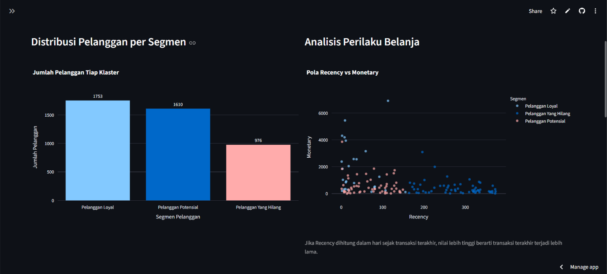
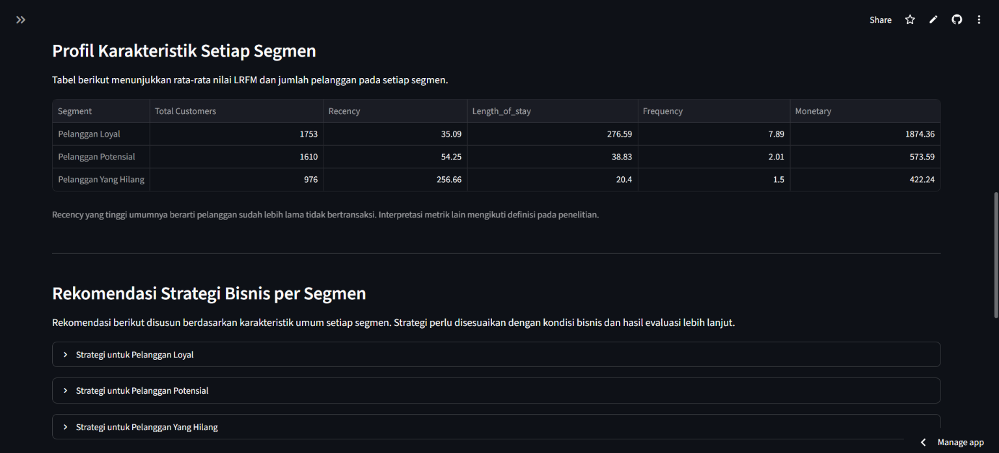
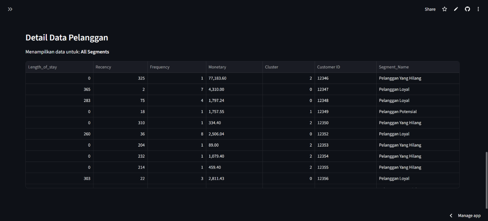

# 📊 Dashboard Segmentasi Pelanggan LRFM

Dashboard web interaktif untuk memvisualisasikan hasil segmentasi pelanggan berdasarkan perilaku transaksi. Proyek ini menggunakan model **LRFM (Length, Recency, Frequency, Monetary)** dan algoritma **Fuzzy C-Means (FCM) Clustering** untuk mengelompokkan pelanggan ke dalam tiga segmen: **Pelanggan Loyal, Pelanggan Potensial, dan Pelanggan Yang Hilang**.

**Demo Aplikasi:** [Customer Segmentation Dashboard](https://customer-segmentation-dashboard-by-alam.streamlit.app/)

## 🛠️ Teknologi yang Digunakan

- **Bahasa Pemrograman:** Python
- **Dashboard:** Streamlit
- **Visualisasi Data:** Plotly Express
- **Pengolahan Data:** Pandas
- **Pembacaan File Excel:** OpenPyXL
- **Pengolahan Data dan Clustering:** Google Colab
- **Algoritma Clustering:** Fuzzy C-Means (FCM)

## ✨ Fitur Utama

- **Filter Data Interaktif:** Memfilter data pelanggan melalui sidebar.
- **Indikator Kinerja (KPI):** Menampilkan jumlah pelanggan, total pendapatan, dan rata-rata frekuensi pembelian.
- **Visualisasi Interaktif:** Menampilkan distribusi dan karakteristik segmen melalui grafik interaktif.
- **Tabel Data Pelanggan:** Menelusuri data pelanggan dengan fitur pengurutan dan pratinjau data.
- **Eksplorasi Segmen:** Membantu pengguna memahami distribusi dan karakteristik masing-masing kelompok pelanggan.
- **Eksplorasi Segmen:** Membantu pengguna memahami distribusi dan karakteristik masing-masing kelompok pelanggan.

## 📸 Tampilan Dashboard

### 1. Dashboard Utama

Halaman utama menampilkan ringkasan metrik pelanggan, termasuk jumlah pelanggan, total nilai Monetary, dan rata-rata frekuensi pembelian.



### 2. Visualisasi Segmen Pelanggan

Visualisasi interaktif untuk mengeksplorasi distribusi pelanggan berdasarkan hasil clustering.



### 3. Karakteristik Setiap Segmen

Menampilkan karakteristik masing-masing segmen berdasarkan metrik LRFM.



### 4. Detail Pelanggan

Menampilkan data pelanggan secara terperinci beserta hasil segmentasinya.



## 🔬 Metodologi

### 1. Pembentukan Fitur LRFM

Model LRFM digunakan untuk merepresentasikan perilaku pembelian pelanggan melalui empat dimensi:

- **Length:** Durasi hubungan pelanggan dengan bisnis.
- **Recency:** Jarak waktu sejak transaksi terakhir pelanggan.
- **Frequency:** Frekuensi transaksi yang dilakukan pelanggan.
- **Monetary:** Nilai transaksi pelanggan secara moneter.

Keempat fitur tersebut digunakan sebagai dasar analisis untuk membentuk segmentasi pelanggan.

### 2. Pra-pemrosesan Data

Pra-pemrosesan dilakukan menggunakan Google Colab untuk mempersiapkan data sebelum proses clustering. Tahapan yang dilakukan meliputi:

- **Penanganan Missing Values:** Mengidentifikasi dan menangani nilai yang kosong.
- **Penghapusan Duplikasi:** Menghapus catatan duplikat untuk mengurangi redundansi data.
- **Normalisasi Fitur:** Menyamakan skala fitur agar perbedaan rentang nilai tidak mendominasi proses clustering.

### 3. Fuzzy C-Means Clustering

Algoritma Fuzzy C-Means (FCM) diterapkan di Google Colab untuk mengelompokkan pelanggan berdasarkan karakteristik LRFM.

- **Algoritma:** Fuzzy C-Means (FCM)
- **Jumlah Cluster:** 3
- **Hasil Segmentasi:** Champions, Potential Loyalists, dan Hibernating/Churn

FCM menghitung derajat keanggotaan setiap data terhadap beberapa cluster. Karakteristik LRFM dari cluster yang dihasilkan kemudian dianalisis untuk menentukan label segmen pelanggan.

### 4. Evaluasi Clustering

Evaluasi hasil clustering dilakukan menggunakan dua metrik, yaitu Silhouette Score dan Davies-Bouldin Index (DBI), dengan normalisasi fitur menggunakan MinMaxScaler.

- **Silhouette Score:** Mengukur kualitas pemisahan cluster. Nilai yang lebih tinggi menunjukkan bahwa data cenderung lebih sesuai dengan clusternya dan lebih terpisah dari cluster lain.
- **Davies-Bouldin Index (DBI):** Mengukur kualitas clustering berdasarkan kekompakan dan pemisahan antarcluster. Nilai yang lebih rendah menunjukkan hasil clustering yang lebih baik.

Pengujian dilakukan terhadap beberapa alternatif jumlah cluster. Hasil evaluasi menunjukkan bahwa tiga cluster memberikan hasil terbaik di antara konfigurasi yang diuji.

| Jumlah Cluster | Silhouette Score | Davies-Bouldin Index |
|---:|---:|---:|
| 2 | 0,5398 | 0,6939 |
| **3** | **0,5633** | **0,5986** |
| 4 | 0,5262 | 0,6546 |
| 5 | 0,4970 | 0,7340 |
| 6 | 0,4660 | 0,8024 |

Berdasarkan hasil tersebut, konfigurasi tiga cluster dipilih untuk proses segmentasi pelanggan. Pemilihan ini didukung oleh Silhouette Score tertinggi sebesar **0,5633** dan Davies-Bouldin Index terendah sebesar **0,5986** pada konfigurasi yang diuji.

Hasil clustering selanjutnya diinterpretasikan berdasarkan karakteristik LRFM untuk membentuk tiga segmen pelanggan: Pelanggan Loyal, Pelanggan Potensial, dan Pelanggan yang Hilang.

### 5. Pengembangan Dashboard

Setelah proses pengolahan data dan clustering selesai di Google Colab, dataset beserta hasil segmentasinya digunakan sebagai input untuk dashboard Streamlit.

Dashboard ini berfokus pada visualisasi dan eksplorasi hasil clustering, bukan menjalankan algoritma Fuzzy C-Means secara langsung. Pengguna dapat memfilter data, melihat indikator kinerja, mengeksplorasi grafik, dan menelusuri data pelanggan.

## 📈 Karakteristik Segmen dan Insight Bisnis

Berdasarkan hasil klasterisasi menggunakan algoritma Fuzzy C-Means (FCM), pelanggan dikelompokkan menjadi tiga segmen berdasarkan karakteristik Length, Recency, Frequency, dan Monetary (LRFM).

### Ringkasan Karakteristik Segmen

| Segmen Pelanggan | Avg. Length | Avg. Recency | Avg. Frequency | Avg. Monetary |
|---|---:|---:|---:|---:|
| Pelanggan Loyal | 276.59 | 35.09 | 7.89 | 4,013.87 |
| Pelanggan Baru | 38.83 | 54.25 | 2.01 | 788.01 |
| Pelanggan Yang Hilang | 20.40 | 256.66 | 1.50 | 621.33 |

### Insight dan Rekomendasi Bisnis

**1. Pelanggan Loyal**

Memiliki rata-rata Length, Frequency, dan Monetary tertinggi dibandingkan segmen lainnya. Hal ini menunjukkan hubungan yang relatif lama dengan bisnis, frekuensi transaksi yang tinggi, serta nilai transaksi yang lebih besar.

Rekomendasi: mempertahankan loyalitas melalui program loyalitas, apresiasi pelanggan, dan penawaran yang relevan.

**2. Pelanggan Baru**

Memiliki rata-rata Length, Frequency, dan Monetary yang relatif rendah. Karakteristik ini menunjukkan hubungan dengan bisnis dan aktivitas transaksi yang masih terbatas.

Rekomendasi: mendorong pembelian berulang melalui promosi yang relevan dan rekomendasi produk. Label segmen ini perlu disesuaikan dengan definisi Length dan periode observasi yang digunakan.

**3. Pelanggan Yang Hilang**

Memiliki rata-rata Recency tertinggi, yaitu 256.66 hari, serta rata-rata Frequency dan Monetary terendah. Hal ini menunjukkan bahwa pelanggan sudah cukup lama tidak bertransaksi dan memiliki aktivitas transaksi yang relatif rendah.

Rekomendasi: menjalankan kampanye reaktivasi melalui penawaran khusus atau komunikasi yang disesuaikan.

### Kesimpulan

Hasil segmentasi menunjukkan perbedaan perilaku transaksi antarsegmen pelanggan. Informasi ini dapat menjadi dasar untuk menyusun strategi retensi pelanggan loyal, mendorong pembelian berulang, dan mengaktifkan kembali pelanggan yang sudah lama tidak bertransaksi.

## 🏗️ Arsitektur Proyek

Proyek ini terdiri dari dua komponen utama:

1. **Pengolahan Data:** Google Colab digunakan untuk pembersihan data, pembentukan fitur LRFM, normalisasi, clustering, dan evaluasi hasil.
2. **Visualisasi Data:** Streamlit digunakan untuk menyajikan hasil segmentasi melalui dashboard interaktif.

### Alur Proses

```text
Data Transaksi Pelanggan
          ↓
Pembersihan Data
          ↓
Pembentukan Fitur LRFM
          ↓
Normalisasi Data
          ↓
Fuzzy C-Means Clustering
          ↓
Evaluasi Cluster
(Silhouette Score & DBI)
          ↓
Interpretasi Segmen
          ↓
Dataset Hasil Segmentasi
          ↓
Dashboard Streamlit
```

## 📁 Struktur Repositori

```text
├── app.py                            # Kode utama dashboard Streamlit
├── customer_segmentation_data.csv    # Dataset pelanggan hasil segmentasi
├── requirements.txt                  # Daftar library Python yang dibutuhkan
├── README.md                         # Dokumentasi proyek
└── screenshots/                      # Screenshot tampilan dashboard
    ├── dashboard.png                 # Tampilan utama dan ringkasan metrik
    ├── visualisasi-segmen.png         # Visualisasi segmentasi pelanggan
    ├── karakteristik-segmen.png       # Karakteristik setiap segmen
    └── detail-pelanggan.png           # Detail data pelanggan
```

## ⚙️ Instalasi dan Menjalankan Aplikasi

### 1. Clone repositori

```bash
git clone URL_REPOSITORI_GITHUB
```

### 2. Masuk ke direktori proyek

```bash
cd NAMA_REPOSITORI
```

### 3. Instal dependensi

Pastikan Python sudah terinstal, lalu jalankan:

```bash
pip install -r requirements.txt
```

Perintah tersebut akan menginstal library yang tercantum dalam `requirements.txt`.

### 4. Jalankan dashboard

```bash
python -m streamlit run app.py
```

Setelah aplikasi berjalan, buka alamat lokal yang ditampilkan pada terminal.

## 🎯 Tujuan Proyek

Proyek ini menunjukkan penerapan pengolahan data, teknik clustering, evaluasi hasil segmentasi, dan visualisasi data interaktif untuk memahami perilaku pelanggan.

Hasil segmentasi disajikan dalam dashboard yang membantu pengguna mengeksplorasi karakteristik kelompok pelanggan dan memperoleh wawasan untuk mendukung analisis bisnis berbasis data.
